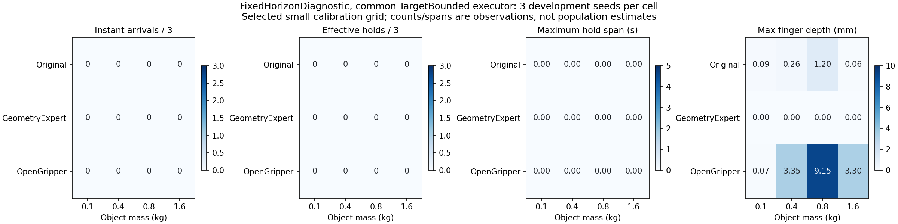

# v0.2 校准：预先冻结的开发性预算

状态：W2完成96回合；W3完成36回合，**W3 Gate未通过**。正式W4/W5学习比较未启动。该文档不改变历史协议与成绩；以下预算段落为原始预登记规则，实际结果在末节。

## W2 重复性

16 个开发条件，质量为 0.1/0.4/0.8/1.6 kg 各四个，模型为原始 SHA babbbfd363f8…。条件在启动前生成并排除已公开 RNG seed。每个条件重复三次，比较一个持续复用环境的 48 回合与每回合新进程的 48 回合，合计96。

固定 GPU 0、LegacyInstant v0.2 仪表、TargetBounded 执行层和严重边界；各组同配置。共享负载逐 worker 记录，既不声称独占，也不干扰其他作业。位级差异、成功标记差异、风险分布和绝对严重事件分别报告。相同模型不得被称为学习更新。

未完成 W1 仪表 smoke 不启动 W2；任何基础设施失败保存已完成物理证据，未完成预算不当作完成结果。96 是预先固定诊断预算，不观察到喜欢的结果就停止。

## W3 范围与停止规则

W2 不证明有安全参考策略。成功后的持稳另用 FixedHorizonDiagnostic，目标 0.05 m、速度0.2 m/s、连续0.30 s（50 Hz 要16个点），报告后续掉落、终态和严重事件。

参考控制器可开发，但必须在相同物理硬件和同一执行层上实际通过新的冻结校准条件。不存在安全可重复正对照时，W3 判未通过；不启动 W4/W5 正式学习比较、不运行18任务 PPO。开发对照和任务可达域的具体新预算须在读取其新结果前另行冻结。

后续三态接纳区分绝对硬边界、相对风险不确定性和任务有效性；INCONCLUSIVE 保留旧版本，不称为已证明危险。仅3次重复不作为精确误判率保证。

### W3 开发正对照尝试的冻结预算（运行前登记）

固定 36 回合：原始策略、已有 GeometryExpert、张爪负对照，各在新的12个条件上运行一次，0.1/0.4/0.8/1.6 kg 各3个独立 seed，生成器种子2026102603。各控制器单独启动一个进程、组内复用 reset，GPU0顺序执行，不能把它当作启动方式对照。三个控制器使用同一5秒 FixedHorizonDiagnostic、TargetBounded、硬边界、接触测量，物理参数不变。GeometryExpert 是以前未成功的教师控制器，纳入是检验共同执行层下是否可用，不预设其成功。

开发 Gate 只认可某个真实参考控制器（原始或教师）在0.1及0.4 kg分别达到至少2/3有效持稳完成，且该控制器12回合均无硬边界事件。负对照12回合应无有效完成；若其完成，需诊断指标的区分能力。同时完整报告高质量域结果、瞬时到达、持稳时间和风险；不能用此小样本宣称精确误判率或稳定自进化。若没有参考通过，不启动W4/W5物理学习比较。不得事后更换指标、延长时限或删除失败条件以使本次通过；进一步开发须另行版本化、登记新预算。

三态门控基础实现使用对固定候选的有界条件均值同时置信区间（Hoeffding + 四指标 Bonferroni），重复观测必须先在条件内聚合。尚未在正负对照上完成阈值校准，所以没有把某组默认非劣界宣称为正式冻结标准。正式多次候选选择还需独立验证包及预分配错误预算；当前API不能替代这一步。

## 2026-10-26 实际结果

### W2 重复性

运行目录 `/home/dell/peb-v02-repeatability-20261026-001`，注册源码 `81c8bb8c63148ddae10430ef79358d6c263832fd`，原始模型SHA未变，49个原生进程、96回合完整完成。16条件每种启动方式三次重复，不能把96行当成96个独立条件。

| 启动方式 | 回合 | 瞬时/持稳完成 | >1mm越界 | 严重事件 | 最大手指越界 | 重复轨迹分歧对数 |
|---|---:|---:|---:|---:|---:|---:|
| 同进程复用reset | 48 | 0 / 0 | 0 | 0 | 0.590 mm | 4/48 |
| 每回合新进程 | 48 | 0 / 0 | 0 | 0 | 0.590 mm | 10/48 |

每种方式16条件×C(3,2)=48个重复比较对；这些对共享回合，不能作为48个独立统计样本。所有比较初始公开物理状态一致，分歧来自后续轨迹数值；96回合任务标记均失败，因此没有任务标记分歧。共享GPU负载逐进程保留，没有宣称独占，没有停止其他作业。

复用方式9/48、新进程10/48在250步时限前以非成功任务终止结束，其余为超时；96回合合计22,254控制步。不能把缺少越界当成“持续安全工作5秒”的证明，也不能忽略失败造成的暴露时长差异。按回合、时长和条件分别保存分母。

同模型并非所有运行都逐位一致，但**没有证据表明这些差异在当前执行层下改变了任务标记**。全部失败形成地板效应，不能据此声称小幅收益/风险判别已校准，更不能倒推历史旧接口的安全误拒已经消失。fresh−reuse成功率差为0，经验条件bootstrap为[0,0]；这是数据无变异导致的退化区间，不是未来零误差保证。单个复用进程块与48个fresh进程也不能估计一般进程总体效应。W2的执行诊断完成，接纳阈值校准仍不足。

### W3 可达域与有效任务

原计划reachability-001在任何仿真启动前取消，实际0回合；为了补全USD body关系和冻结推理YAML，36回合移至reachability-002。两次注册、取消原因和零实际成本均保留。新版本源码 `67770df`，每worker保存并校验推理 `policy_config.yaml` 的SHA；物理边界与执行层未改变。

| 控制器 | 质量kg | 回合 | 瞬时完成 | 有效持稳 | 最长持稳s | >1mm越界回合 | 最大指越界mm |
|---|---:|---:|---:|---:|---:|---:|---:|
| Original | 0.1 | 3 | 0 | 0 | 0 | 0 | 0.087 |
| Original | 0.4 | 3 | 0 | 0 | 0 | 0 | 0.259 |
| Original | 0.8 | 3 | 0 | 0 | 0 | 1 | 1.202 |
| Original | 1.6 | 3 | 0 | 0 | 0 | 0 | 0.059 |
| GeometryExpert | 0.1 | 3 | 0 | 0 | 0 | 0 | 0.002 |
| GeometryExpert | 0.4 | 3 | 0 | 0 | 0 | 0 | 0.001 |
| GeometryExpert | 0.8 | 3 | 0 | 0 | 0 | 0 | 0.002 |
| GeometryExpert | 1.6 | 3 | 0 | 0 | 0 | 0 | 0.001 |
| OpenGripper | 0.1 | 3 | 0 | 0 | 0 | 0 | 0.068 |
| OpenGripper | 0.4 | 3 | 0 | 0 | 0 | 1 | 3.352 |
| OpenGripper | 0.8 | 3 | 0 | 0 | 0 | 1 | 9.153 |
| OpenGripper | 1.6 | 3 | 0 | 0 | 0 | 1 | 3.299 |

36回合均完成250控制步、1000物理采样；没有触发严重边界。三组均无瞬时到达，最长有效持稳均0，因此“瞬时到达后掉落/维持”的行为在这批校准中**没有被触发，无法验证该行为的区分能力**。张爪负对照为零只是必要条件，不代表评价器已能识别好策略与坏策略；正对照缺失使该区分尚不成立。

几何教师的失败也不能等同于任务物理不可达。GeometryExpert-000（0.1kg）的公开末端轨迹表明，第99控制步距下降目标仍约0.328m，第129步仍约0.185m，而旧教师按固定时间表在第100步闭合、第130步转入提升。它在受限执行层下尚未抵达抓取位置就进入下一阶段。第249步末端可接近它自己的提升目标约2mm，但物体没有完成任务。这说明当前教师的开环时序没有完成执行层兼容校准；**不能把教师末端跟踪到目标当成抓取成功**。下一步应开发基于实际几何状态切换的控制器并验证参数作用，另开有界开发预算；不能事后把本轮教师失败删除或放宽本轮5秒规则。

W3结论：**未通过**。没有控制器达到低质量两档各≥2/3有效持稳的冻结门槛。正式W4/W5四组研究没有运行，新增PPO训练转移为0。Agent接口仅完成CPU合约和持久文件读回测试，不能声称自主Agent进化已进入物理验证。
