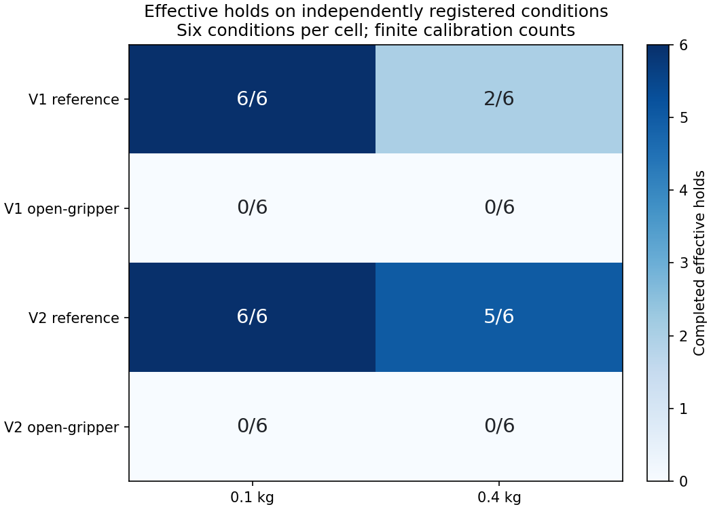
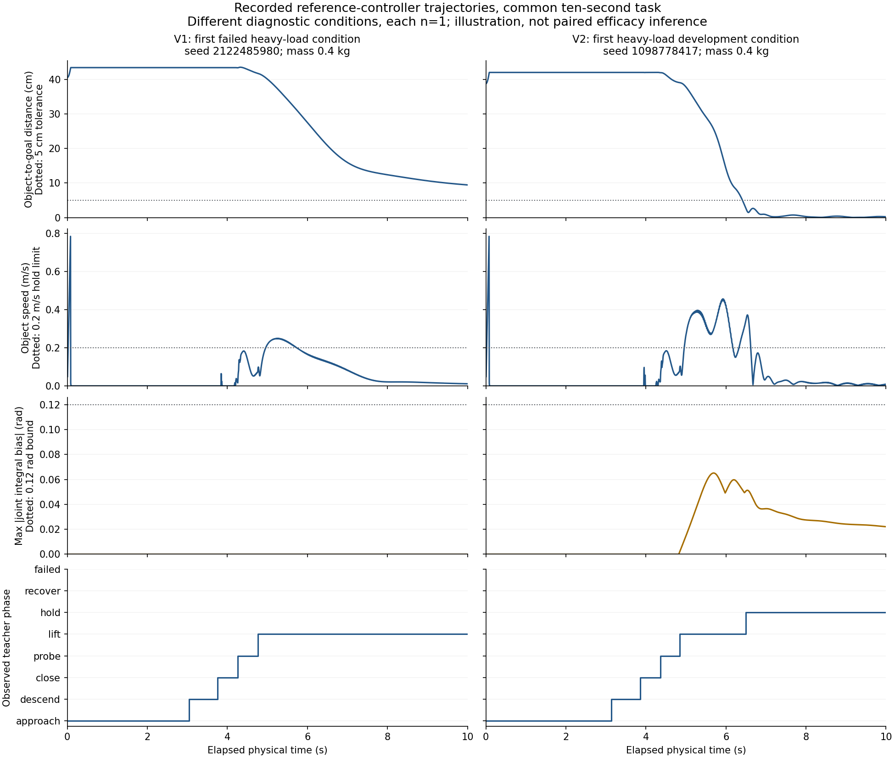

# 基于状态的参考控制器实施报告

2026-10-26；接续[上一阶段153回合诊断](V02_阶段实施报告_20261026.md)。目标是先建立可测、可重复的参考完成方式，随后才有条件研究Agent学习。

**原五秒任务仍未通过；新十秒参考v1复测失败，v2独立参考校准通过。** v2参考轻载6/6、重载5/6有效持稳，张爪0/12，参考无>1mm越界。本轮没有PPO训练或实际自主Agent比较；另行登记的四回合参数作用检查也已完成，两项变量均有实际作用证据。

## 1. 实施了什么

旧GeometryExpert第100步闭合、第130步提升，实际尚未抵达抓取位置。现在新增独立的StateBasedReference，旧实现和旧分数保留。新状态机按实际状态执行：

| 阶段 | 进入下一阶段的依据 |
|---|---|
| approach | 到达物体上方位置，位置/姿态误差满足阈值并连续保持 |
| descend | 抵达抓取位置且姿态对齐 |
| close | 至少等待指定时间，双指cube法向接触存在且夹爪开度不是空夹紧 |
| probe | 先小幅试提，物体真实上升且物体与末端相对位置保持 |
| lift | 经物体随动确认后，才朝任务目标提升 |
| hold | 物体进入目标区域后继续保持；独立评分器检查速度与连续0.30秒 |
| recover | 未确认抓取或丢失物体时张爪退回，最多一次恢复 |

教师不接收质量真值、seed或评分结果。输入为几何、速度、公开目标和接触量。阶段名本身不算成功，成功依旧从post-physics物体状态重算。临时接触、空夹爪闭合、瞬时到达均不能代替有效持稳。

物理硬件、碰撞、重力、驱动、effort/velocity限值及执行层保持原配置；arm目标变化率上限1rad/s、finger0.04m/s、live hard position bounds不变。所有本轮worker顺序使用共享GPU2，避免显存较紧的GPU0，不停止其他任务。原生与CPU虚拟环境继续分开，上游Arena/Lab源码不改。

单位说明：本轮冻结代码的first_violation阈值一直是每个关节坐标深度>0.001，即手指1mm、机械臂0.001rad；严重停止边界另为手指0.01m/机械臂0.1rad。部分早期协议把前者简写成“>1mm关节越界”，这里澄清单位，未改变数值、程序或历史判定。本轮各参考与负对照的机械臂越界深度均为0。

## 2. 五秒开发结果：抓取恢复了，完整任务没有完成

首批四个全新0.1kg条件，原五秒时限，持稳0/4、无手指>1mm或机械臂>0.001rad越界。四回合都完成了双指接触和物体随动确认，但到第225–231控制步（约4.5–4.6秒）才进入正式提升。目标仍有约0.23–0.33m误差，剩余时间只有0.38–0.50秒。

这验证了状态切换避免旧教师的盲目闭合/提升，不证明任何控制器都无法在五秒内完成。首批原始time_extension_evidence=false、冻结资格false均保留。

随后另行提交[十秒版本协议](../experiments/STATE_REFERENCE_H10_PROTOCOL_20261026.md)：明确增加“已验证抓取但提升耗尽时限”的开发准入，新建state-reference-h10-v1任务，不更改旧五秒评分。四个新0.1kg开发条件持稳4/4、最长合格持稳约3.92–4.14秒、无>1mm越界，取得冻结资格。

## 3. v1独立复测失败，没有挑seed重试

冻结实际源码2d5be3d及配置，写入内容寻址artifact，新原生进程只根据该文件重建控制器。新条件0.1/0.4kg各6个，加同源强制张爪负对照12回合，合计24。

| v1独立组 | 质量 | 回合 | 有效持稳 | >1mm越界回合 |
|---|---:|---:|---:|---:|
| reference | 0.1kg | 6 | 6 | 0 |
| reference | 0.4kg | 6 | 2 | 0 |
| open-gripper | 0.1kg | 6 | 0 | 0 |
| open-gripper | 0.4kg | 6 | 0 | 0 |

参考每档≥5/6的冻结门槛未满足，v1 Gate为失败。12个负对照也完整跑完。参考组8个成功回合在原始终止前状态均满足位置和速度条件，未发现首次持稳之后离开目标区域；这没有挽救重载四次失败。

失败回合已抓住物体，但在升向目标后保持厘米级或约0.09m偏差。读取配置确认原关节PD stiffness=80；原教师有机器人自身重力前馈，却每步从实际关节位置重算短步IK目标，没有积累持续负载误差。这支持检验有界积分补偿，不能宣称已证明唯一根因或仿真器缺陷。

## 4. v2是新控制程序，不是原控制器换seed

依据[新v2协议](../experiments/STATE_REFERENCE_V2_PROTOCOL_20261026.md)，使用剩余四个开发回合，保持总教师开发上限12。只测试一种新程序：已验证抓取后的lift/hold阶段，对有界关节反馈增量积分，gain=1.0/s、偏置限制±0.12rad；其他阶段和episode reset清零。输入不含质量，驱动、effort和物理参数不变。积分输入和状态逐步保存并独立重算。

四个全新0.4kg开发条件持稳4/4，最长持稳约2.36–3.38秒，无>1mm越界，终态4/4有效且没有测得持稳后离开目标。冻结c8017dd源码和配置，另注册**一次**24回合新独立复测。v1的24个原始结果完整保留，不与v2合并为一组确认样本。

v2独立参考门槛仍为每档≥5/6有效持稳，参考12回合无>1mm越界或严重事件，张爪0/12；失败则本阶段停止，不启动更多教师开发或重选条件。

### v2独立结果

已完成24回合，Gate通过：0.1kg参考6/6有效持稳，0.4kg参考5/6；两档张爪各0/6。参考和负对照均无手指>1mm或机械臂>0.001rad越界。重载参考有一回合瞬时到达，但最长合格持稳仅0.16秒，仍按失败计；没有降低0.30秒标准。这个结果只验证有限条件下新十秒任务的参考完成方式，不改变旧五秒失败，也不是Agent自进化证据。

| v2独立组 | 质量 | 回合 | 瞬时到达 | 有效持稳 | 坐标越界回合 |
|---|---:|---:|---:|---:|---:|
| reference | 0.1kg | 6 | 6 | 6 | 0 |
| reference | 0.4kg | 6 | 6 | 5 | 0 |
| open-gripper | 0.1kg | 6 | 0 | 0 | 0 |
| open-gripper | 0.4kg | 6 | 0 | 0 | 0 |

12个参考回合的终止前状态均在目标范围且速度≤0.2m/s，但其中一例不足连续0.30秒，仍为失败。另有一例在首次合格持稳后暂时离开目标区域，后来回到区内；因此不能描述成所有回合全程稳定驻留。补充的reference_terminal_followup.json独立记录这些事实，不更改冻结成功定义。





轨迹图是按固定规则选取的两个不同条件、各n=1，说明实际位置/速度、阶段和积分量，不能当作配对效果估计。独立计数每格6条件，不给出学习算法总体保证。

## 5. 接触量范围修正

安装版本base_contact_sensor_data.py明确把net_forces_w映射为net_normal_forces_w、force_matrix_w映射为normal_force_matrix_w，并给出后端警告。此前别名返回的数值仍保留，但应限定为**净法向力与cube配对法向力**；切向接触力未测量，不是完整总接触力。

新源码直接读取normal字段、保存实际属性名与范围。不能把这些量当作完整接触安全或真实求解器关节驱动力，也不能仅凭差值唯一认定桌面或自碰撞来源。

## 6. 可执行冻结产物与Agent接口边界

冻结文件包含源码commit、状态配置、任务ID/时限和checkpoint上下文SHA，附内容摘要。确认过程加载该文件，注册相同配置，启动独立原生进程；审计检查所有worker计划与artifact完全一致。它证明参考控制程序可从持久文件重建，不依赖旧实例聊天状态，不能算作Agent自主生成技能的实证。

父适配器遗留的row.skill_sha256只表示原checkpoint/gain上下文，不是完整教师程序身份，不能据此把v1/v2当成同一策略。追加的controller_identity.json按注册源码、控制器类型、完整配置、任务/执行层和checkpoint上下文计算effective_controller_sha256，不包含seed、质量或结果；原始row不改。baseline和identity的完整身份相同，两个参数变体不同；v1/v2及张爪对照也分别区分。

ReferenceAgentAdapter和ReferenceSkill只准备了两个有界变量：接近高度、最小闭合等待；不可修改源码、硬件、评分器或任务时限。内容相同得到相同引用，冻结后新实例可读回，质量/seed/heldout工具仍被拒绝。原参数开发槽因v1失败没有启动，剩余教师开发预算用于v2，12回合上限没有绕过。随后按另行提交的W4作用协议注册4个独立诊断回合，验证两个参数的作用；实际模型驱动的Agent工具循环仍未运行。

W4作用检查采用一个新0.1kg条件，baseline、identity、clearance=0.12m、minimum_close=0.70s各启动新进程，实际4回合全部有效持稳、无坐标越界、终态也满足位置/速度条件。四者初始物理状态一致。clearance在相同输入重算和实际下发中都从第0步起改变目标；close等待在相同输入重算中第210步改变命令，实际下发目标在该步后也有变化。两项参数有真实执行作用。

identity与baseline内容哈希相同，但从第190步起实际目标已有数值分歧；baseline首次合格持稳为7.12秒，identity为8.92秒。这个差别不能算进化收益。单条件作用诊断也不能证明某个参数设置更优，尚未校准细小收益/风险变化的统计接纳能力。

## 7. 代码与复核入口

- [纯状态机与有界积分](../../physicalevobench/v02/reference.py)
- [原生DLS执行器](../../physicalevobench/v02/reference_native.py)
- [内容寻址冻结产物与受限技能](../../physicalevobench/v02/reference_artifact.py)
- [开发/独立确认启动器](../../scripts/run_reference_calibration.py)
- [从原始状态重算阶段和门控](../../scripts/report_reference_calibration.py)
- [参数作用诊断实现](../../scripts/run_reference_parameter_effects.py)

本地运行目录为 `/home/dell/peb-reference-dev-b1-20261026-001`、`dev-b2`、`dev-b3`、`confirm`、`confirm-v2`、`activation`（后五个同前缀peb-reference及日期后缀）。每次先提交代码、登记预算/条件/SHA、再启动；raw actions、processed/applied targets、物理子步、pre-reset terminal、阶段/接触/积分、GPU负载与returncode全部保留。

CPU当前98项测试与Ruff通过。新增测试检查：时间不能触发未到位闭合、单指/空夹爪不能确认抓取、必须物体随动才能正式提升、有界积分不累积到上限之外且跨阶段清零、artifact篡改拒绝、新实例读回、受限参数不能改物理真值。

## 8. 完整成本与交付

| 阶段 | 实际回合 | 控制步 | 物理子步记录 | 原生进程 |
|---|---:|---:|---:|---:|
| 五秒状态机开发 | 4 | 1,000 | 4,000 | 1 |
| 十秒v1开发 | 4 | 2,000 | 8,000 | 1 |
| v1独立确认（失败保留） | 24 | 12,000 | 48,000 | 2 |
| 十秒v2重载开发 | 4 | 2,000 | 8,000 | 1 |
| v2独立确认 | 24 | 12,000 | 48,000 | 2 |
| 独立W4参数作用诊断 | 4 | 2,000 | 8,000 | 4 |
| **本轮合计** | **64** | **31,000** | **124,000** | **11** |

教师开发12与独立确认48合计60，W4作用检查另行注册4，总计64，没有把新增阶段塞进旧预算。原生进程墙钟合计约48.67分钟，含建场/加载；模拟控制时间620秒，不是独占GPU计算时间。新增训练转移0，实际Agent学习比较0。上一轮153个回合另列，不能混入本轮确认样本。

64回合包含37个不同条件：12个教师开发条件，两版独立确认各12个条件（每条件reference/open两回合），参数诊断一个条件重放四次。它们不是64个独立条件；两版确认也不是同一条件配对的算法效果研究。

归档入口：[完整原始证据及独立审计](../evidence/state-reference-20261026/README.md)。公开校验不需要私有模型或SimulationApp：

```bash
uv run python scripts/verify_stability_delivery.py \
  --evidence docs/evidence/state-reference-20261026 \
  --output /tmp/peb-state-reference-audit-NEW
```

审计重新解包、核对源文件与数据SHA、预算/质量/冻结artifact/目标映射/完整物理子步/终态；重算状态转换、物体随动、积分、两版独立Gate、终态后续观察和参数作用。源码和模型上下文SHA绑定，模型权重及HDF5不分发。图表来源SHA随图保存。

原五秒参考校准与上一轮W3失败保持不变。新十秒任务已建立有限条件下的正对照和可作用接口；实际模型驱动的Agent闭环、公平搜索对照、跨学习种子稳定收益仍待新的研究，**本轮没有证明稳定自进化**。
